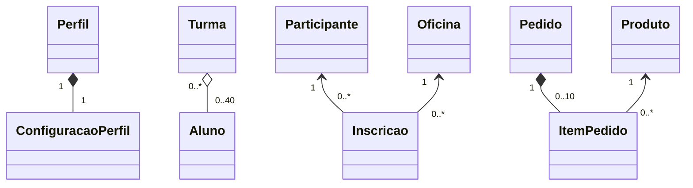

# 03 · Associações entre objetos

Uma associação liga objetos que colaboram. Em Java, um atributo pode guardar a referência a outro objeto ou a várias instâncias em um array ou uma coleção. O código deve expressar as quantidades permitidas e as regras para criar e desfazer cada vínculo.

## Multiplicidade e direção

| Multiplicidade | Leitura | Exemplo |
| --- | --- | --- |
| `1` | Exatamente um | Cada perfil possui uma configuração. |
| `0..1` | Opcional, até um | Cada assento tem uma reserva enquanto estiver ocupado. |
| `0..40` | De zero até quarenta | Cada turma tem até quarenta alunos. |
| `0..*` | Qualquer quantidade a partir de zero | Uma oficina pode receber várias inscrições. |
| `1..*` | Pelo menos um | Em um domínio que exige itens para concluir uma venda, um pedido concluído tem um ou mais itens. |

Leia cada extremo a partir de uma instância do outro extremo. Em `Perfil 1 — 1 ConfiguracaoPerfil`, cada perfil tem uma configuração e cada configuração pertence a um perfil. Em `Turma 0..* — 0..40 Aluno`, cada turma tem até quarenta alunos e o mesmo aluno pode participar de várias turmas. O array implementa apenas a navegação de turma para aluno.

Uma associação unidirecional guarda a referência de um lado. Uma associação bidirecional permite consultar os dois sentidos. É possível manter uma fonte de verdade e consultar os dois sentidos a partir dela, como a agenda de inscrições. Se o modelo guardar referências nos dois objetos, centralize a operação que atualiza as duas pontas e valide todas as regras antes de modificar o estado.

## Agregação e composição

Na agregação, um todo reúne objetos que têm identidade própria e podem ser compartilhados. `Turma` recebe instâncias de `Aluno` já existentes, inclusive uma que também participa de outra turma.

Na composição, o todo controla a criação e a participação de suas partes no domínio. `Pedido` cria cada `ItemPedido` internamente a partir de um `Produto` e de uma quantidade. O pedido expõe uma coleção imutável de itens para consulta. Um item pertence a um único pedido, enquanto o mesmo produto pode aparecer em diferentes pedidos.

## Exemplos executáveis

Execute os comandos na raiz com um JDK 17 ou superior.

| Exemplo | O que observar | Comando |
| --- | --- | --- |
| [Perfil e configuração](src/associacoes/perfil/DemoPerfil.java) | Composição 1:1 e configuração própria de cada perfil. | `bash scripts/executar.sh associacoes.perfil.DemoPerfil` |
| [Turma e alunos](src/associacoes/turma/DemoTurma.java) | Array de objetos, contador manual, limite de 40 alunos e elemento compartilhado. | `bash scripts/executar.sh associacoes.turma.DemoTurma` |
| [Oficinas e participantes](src/associacoes/oficinas/DemoOficinas.java) | Relação N:N com uma entidade de ligação que guarda a data de inscrição. | `bash scripts/executar.sh associacoes.oficinas.DemoOficinas` |
| [Pedido, itens e produtos](src/associacoes/pedidos/DemoPedido.java) | Composição 1:N, produtos reutilizáveis e subtotais em centavos inteiros. | `bash scripts/executar.sh associacoes.pedidos.DemoPedido` |
| [Planetário](src/associacoes/planetario/DemoPlanetario.java) | Reserva opcional por assento, posição pública a partir de 1 e cancelamento que libera uma vaga. | `bash scripts/executar.sh associacoes.planetario.DemoPlanetario` |

Em [`Turma`](src/associacoes/turma/Turma.java), os elementos válidos ocupam `0` até `quantidade - 1`. A inserção verifica a capacidade e a matrícula antes de escrever. A consulta copia o trecho ocupado do array, preservando o estado da turma caso alguém altere a cópia. Os objetos `Aluno` são imutáveis e podem ser reutilizados.

Na [`AgendaOficinas`](src/associacoes/oficinas/AgendaOficinas.java), o operador `==` compara as referências. Duas pessoas com o mesmo nome podem se inscrever na mesma oficina quando são representadas por objetos distintos. Compare esse desenho com `Turma`, que usa a matrícula para reconhecer o mesmo aluno mesmo quando há duas instâncias em memória.

No [`Pedido`](src/associacoes/pedidos/Pedido.java), os preços são expressos em centavos. Três unidades de 250 centavos geram um subtotal de 750 centavos. A formatação em reais pertence à demonstração, e o total usa `long` para acomodar a multiplicação de preço por quantidade e a soma das linhas.

As verificações do módulo estão em [perfil](src/associacoes/perfil/VerificacaoPerfil.java), [turma](src/associacoes/turma/VerificacaoTurma.java), [oficinas](src/associacoes/oficinas/VerificacaoOficinas.java), [pedido](src/associacoes/pedidos/VerificacaoPedido.java) e [planetário](src/associacoes/planetario/VerificacaoPlanetario.java).

## Prática

- [Roteiro da Lista 4 da A1](exercicios/lista-a1.md)
- [Cinco exercícios originais](exercicios/README.md)
- [Gabaritos comentados](exercicios/gabarito.md)
