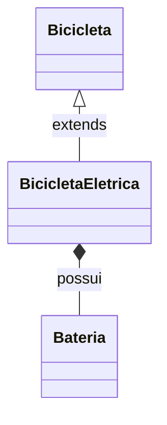

# 05 · Hierarquia e herança

Em Java, `class Subclasse extends Superclasse` declara que instâncias da subclasse também podem ser usadas como instâncias da superclasse. Uma impressora 3D é um equipamento e pode ser ligada pela mesma rotina que prepara um scanner. Os dois objetos mantêm estados independentes.

## Exemplos em Java

| Exemplo | O que observar | Classe executável |
| --- | --- | --- |
| [Equipamentos de laboratório](src/heranca/equipamentos/DemoEquipamentos.java) | `Impressora3D` e `ScannerMesa` usam `super(identificacao)` para inicializar a parte de `Equipamento`. A impressora controla seu filamento, enquanto o scanner controla cada digitalização. | `heranca.equipamentos.DemoEquipamentos` |
| [Bicicleta elétrica](src/heranca/transporte/DemoComposicao.java) | A elétrica pode ser pedalada como qualquer bicicleta. A bateria é um objeto interno que a bicicleta usa apenas nas voltas assistidas. | `heranca.transporte.DemoComposicao` |
| [Ingresso estudantil](src/heranca/exercicio/DemoIngresso.java) | A subclasse reaproveita a validação da classe base e aplica o desconto à tarifa herdada. | `heranca.exercicio.DemoIngresso` |

Execute os exemplos a partir da raiz do repositório.

```bash
bash scripts/executar.sh heranca.equipamentos.DemoEquipamentos
bash scripts/executar.sh heranca.transporte.DemoComposicao
bash scripts/executar.sh heranca.exercicio.DemoIngresso
```

## Construtores e visibilidade

Construtores inicializam a própria classe e não são herdados. Quando o construtor da superclasse exige argumentos, a subclasse usa `super(...)` para fornecê-los. Quando a classe base tem um construtor sem argumentos acessível, o Java pode inserir `super()` automaticamente. O [construtor de `Impressora3D`](src/heranca/equipamentos/Impressora3D.java) passa a identificação para a base e, depois, valida a quantidade de filamento.

O campo `ligado` é privado em [`Equipamento`](src/heranca/equipamentos/Equipamento.java). As subclasses usam o método `protected final exigirLigado()` para compartilhar uma regra de validação. Assim, a classe base controla quem altera o estado e mantém o mesmo comportamento para ligar, desligar e consultar todos os equipamentos. Em Java, membros `protected` também são acessíveis no próprio pacote. Fora do pacote, o acesso de uma subclasse a um membro de instância herdado tem restrições sobre o tipo da referência usada.

## Escolha entre herança e composição



Pergunte se o objeto especializado atende ao contrato da classe base. [`BicicletaEletrica`](src/heranca/transporte/BicicletaEletrica.java) preserva a operação `pedalarUmaVolta()` inclusive quando a carga chega a zero. A operação extra `pedalarComAuxilio()` informa se houve assistência e preserva o contador nas tentativas sem carga. [`Bateria`](src/heranca/transporte/Bateria.java) tem um contrato diferente, centrado na capacidade e na recarga, e fica sob o controle da bicicleta.

Em Java, uma classe estende diretamente uma única classe. A composição permite reunir objetos com funções diferentes, como bateria e motor em uma bicicleta elétrica. O [módulo 06](../06-polimorfismo-classes-abstratas/) apresenta interfaces para compartilhar contratos entre tipos.

## Prática

- Resolva os [exercícios de herança](exercicios/README.md), começando pela meia-entrada e chegando ao diagnóstico de uma hierarquia que quebra seu contrato.
- Consulte o [gabarito comentado](exercicios/gabarito.md) depois de comparar sua execução com os cenários propostos.
- Confira os exemplos com as verificações executáveis da trilha.
