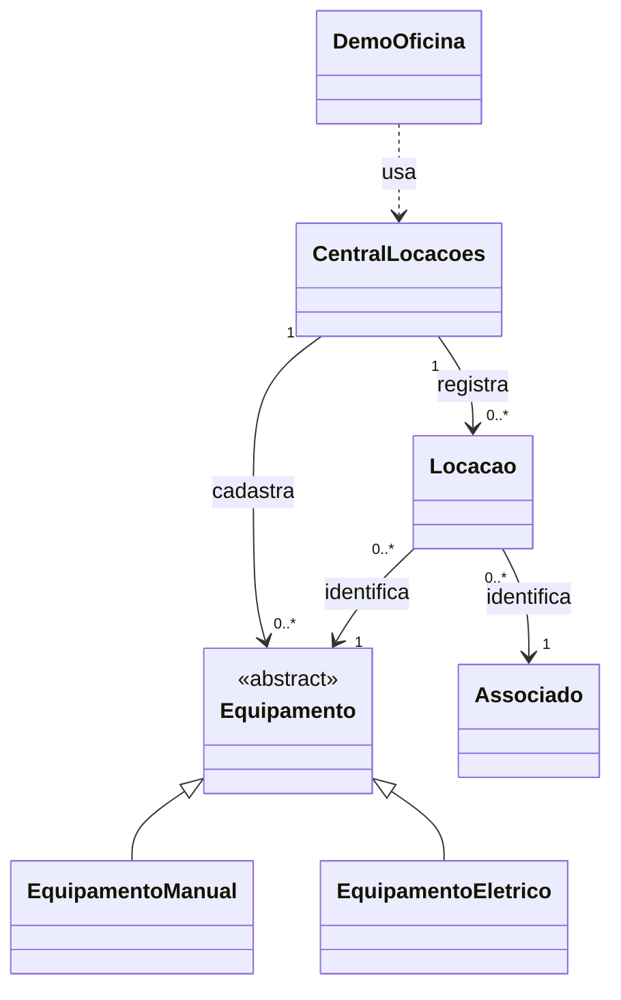

# 08 · Projeto integrador — locadora da oficina comunitária

Uma oficina cadastra ferramentas manuais e elétricas. Um associado pode retirar várias ferramentas, e cada unidade pode ter no máximo uma locação aberta. O histórico guarda registros abertos e devolvidos.

## Execute o cenário

Rode os comandos da raiz do repositório com JDK 17 ou superior.

```bash
bash scripts/executar.sh projeto.DemoOficina
bash scripts/executar.sh projeto.VerificacaoOficina
```

```text
Lia com Alicate até 2026-06-12 — R$ 10,00
Lia com Furadeira até 2026-06-12 — R$ 33,00
Furadeira devolvida: true
Locações no histórico: 2
```

## Regras do domínio

- Cada equipamento tem um código único e uma diária positiva. Os valores ficam em centavos até a apresentação. O preço de um equipamento manual é a diária vezes a quantidade de dias. O elétrico soma uma taxa de manutenção por retirada.
- A abertura exige um equipamento do acervo e uma quantidade positiva de dias. A devolução prevista é a data de retirada acrescida desses dias, e o valor é fixado na abertura.
- Cada devolução identifica uma locação específica. O registro deve pertencer à central, estar aberto e ter data de devolução igual ou posterior à retirada. A devolução libera o equipamento e o registro fica disponível para consulta.
- As verificações de abertura precedem a inclusão no histórico. Uma tentativa recusada mantém os registros existentes. A consulta devolve uma lista somente para leitura com os registros presentes naquele instante. Os próprios registros refletem devoluções posteriores.

## Mapa das classes



| Leia na ordem | Responsabilidade |
| --- | --- |
| [DemoOficina](src/projeto/DemoOficina.java) | Fornece as entradas do cenário e apresenta os resultados. |
| [CentralLocacoes](src/projeto/locacao/CentralLocacoes.java) | Coordena cadastro, abertura, devolução e consulta. |
| [Locacao](src/projeto/locacao/Locacao.java) e [Associado](src/projeto/locacao/Associado.java) | Representam as pessoas e os registros de retirada em `projeto.locacao`. |
| [Equipamento](src/projeto/equipamentos/Equipamento.java), [manual](src/projeto/equipamentos/EquipamentoManual.java) e [elétrico](src/projeto/equipamentos/EquipamentoEletrico.java) | Definem a cobrança compartilhada e a regra específica de cada tipo em `projeto.equipamentos`. |
| [VerificacaoOficina](src/projeto/VerificacaoOficina.java) | Exercita valores, histórico, devolução em data inválida, duplicidade e tentativas repetidas. |

| Pilar | Onde aparece |
| --- | --- |
| Abstração | O modelo retém apenas o que é necessário para cadastrar, cobrar, retirar e devolver equipamentos. |
| Encapsulamento | `Locacao` guarda a data de devolução em um atributo privado e valida a transição dentro do pacote. A central controla o acesso ao acervo e ao histórico. |
| Herança | Os dois equipamentos estendem a classe abstrata e reutilizam o estado, a validação e o cálculo das diárias. |
| Polimorfismo | A central trata todo equipamento pelo tipo `Equipamento`. A chamada à taxa dentro do cálculo aciona a implementação do objeto real. |

A disponibilidade deriva do histórico. Em um acervo pequeno, percorrer os registros simplifica a regra de exclusividade. Guardar a disponibilidade em um segundo atributo exigiria sincronizar esse atributo com cada abertura e devolução.

A [lista de extensões](exercicios/README.md) propõe novas regras de cobrança, consultas e reservas, com exemplos de aceitação.
